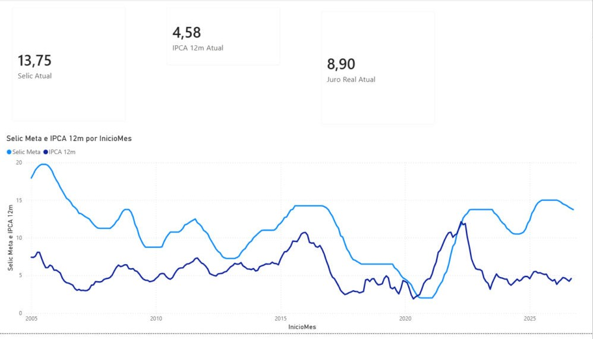
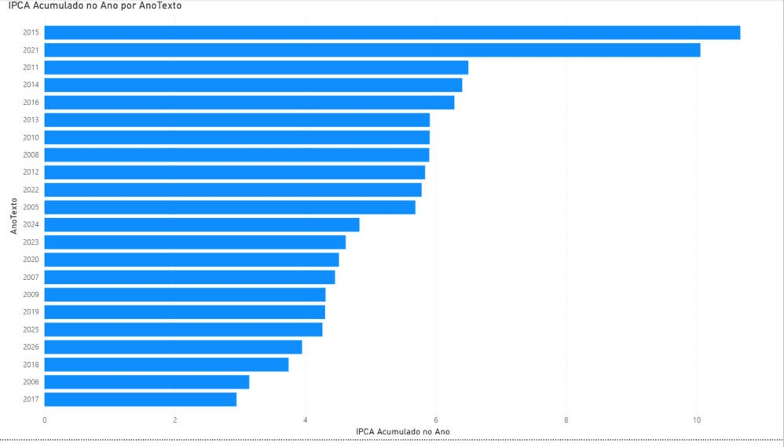
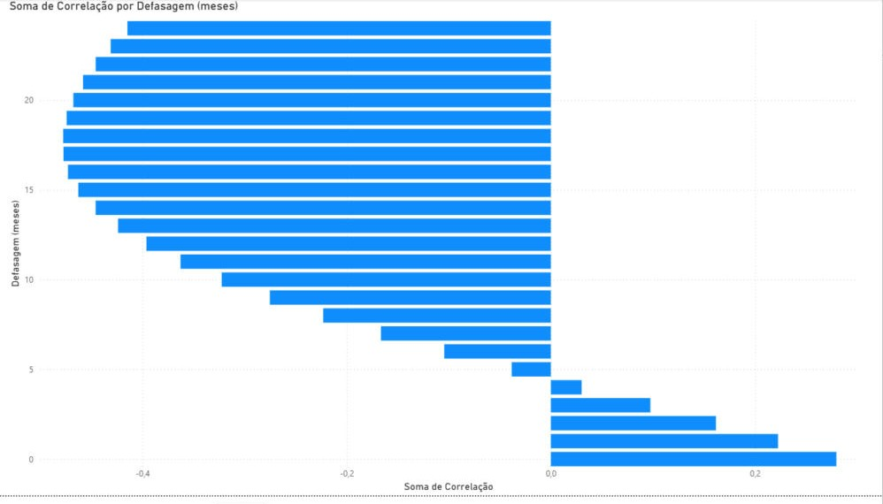

# Relatório no Power BI

Roteiro e código para montar no Power BI Desktop um relatório sobre os dados do projeto, consumindo a API publicada. O tratamento dos dados fica no Power Query e os indicadores em DAX, sobre um modelo estrela.

## O que tem aqui

| Arquivo | O que faz |
| --- | --- |
| [power-query/dSerie.pq](power-query/dSerie.pq) | Dimensão com as séries (código, nome, unidade, periodicidade) |
| [power-query/fObservacoes.pq](power-query/fObservacoes.pq) | Fato em formato longo: uma linha por série e mês, com tipos e duplicados tratados |
| [power-query/fJuroReal.pq](power-query/fJuroReal.pq) | Juro real calculado pela API, para conferir a medida DAX |
| [power-query/fCorrelacao.pq](power-query/fCorrelacao.pq) | Correlação Selic x IPCA de 0 a 24 meses de defasagem |
| [dax/dCalendario.dax](dax/dCalendario.dax) | Tabela de datas |
| [dax/medidas.dax](dax/medidas.dax) | Medidas: Selic, IPCA, juro real, IPCA acumulado no ano, variações e cartões |

## O relatório

Montado no Power BI Desktop com o código desta pasta, em três páginas, consumindo a API publicada.

**Visão geral:** Selic, IPCA 12 meses e juro real atuais, e a Selic contra o IPCA desde 2005.



**Inflação:** IPCA acumulado em cada ano, do maior para o menor. 2015 (10,7%) e 2021 (10,1%) lideram, iguais aos números oficiais do IBGE. O ano corrente aparece com a inflação acumulada até o último mês disponível.



**Defasagem:** correlação entre a Selic de um mês e o IPCA 12 meses de N meses depois. Fica negativa a partir de uns 5 meses e chega perto de -0,48 entre 17 e 20 meses: juro alto costuma vir acompanhado de inflação menor mais de um ano depois. É correlação, não prova de causa.



## Modelo

```
dSerie (SerieId) 1 ──── * fObservacoes (SerieId, Data, Valor) * ──── 1 dCalendario (Date)
                                                                          │
                                                       fJuroReal (Data) * ┘
fCorrelacao (sem relacionamento)
```

## Passo a passo

**1. Parâmetro da API.** Em Página Inicial > Transformar dados > Gerenciar parâmetros, crie `ApiBase` (tipo Texto) com o valor `https://brasil-econ-api.onrender.com`. A API dorme em plano gratuito: abra a [demonstração](https://brasil-econ-dashboard-apps.vercel.app) um minuto antes de atualizar, ou espere o primeiro acesso.

**2. Consultas.** No Power Query, crie uma Consulta Nula para cada arquivo de `power-query/` (Nova fonte > Consulta Nula > Editor Avançado), cole o código e dê à consulta o nome do arquivo, sem a extensão. Crie nesta ordem: `dSerie`, `fObservacoes`, `fJuroReal`, `fCorrelacao`. Na primeira conexão, escolha acesso **Anônimo** (a API é pública).

**3. Tabela de datas.** Em Modelagem > Nova tabela, cole `dax/dCalendario.dax`. Marque como tabela de datas (coluna `Date`) e ordene `Mes` por `MesNumero`. Crie também a coluna `AnoTexto = FORMAT ( dCalendario[Date], "yyyy" )`: como texto, o ano vai direto para o eixo dos gráficos em vez de ser somado.

**4. Relacionamentos.** No modo de exibição de modelo:
- `dSerie[SerieId]` 1:* `fObservacoes[SerieId]`
- `dCalendario[Date]` 1:* `fObservacoes[Data]`
- `dCalendario[Date]` 1:* `fJuroReal[Data]`

**5. Medidas.** Crie uma tabela vazia `_Medidas` (Inserir dados > Carregar) e adicione as medidas de `dax/medidas.dax`, uma por vez.

**6. Páginas.** As três primeiras estão no relatório publicado; as outras são sugestões.
- **Visão geral:** cartões `Selic Atual`, `IPCA 12m Atual` e `Juro Real Atual`; gráfico de linhas com `Selic Meta` e `IPCA 12m` por `dCalendario[InicioMes]`; segmentação por `Ano`.
- **Inflação:** barras com `IPCA Acumulado no Ano` por `AnoTexto`; matriz `Ano` x `Mes` com `IPCA Mensal` e formatação condicional em escala de cor.
- **Juro real e dólar:** linha com `Juro Real (Fisher)`; colunas com `Dólar Variação Mensal %` (cor diferente para valores negativos).
- **Defasagem:** barras com `fCorrelacao[Correlação]` por `Defasagem (meses)` (configure a coluna como "Não resumir" para ela ir ao eixo).

**7. Conferência.** Numa tabela com `dCalendario[InicioMes]`, `Juro Real (Fisher)` e `Diferença Juro Real vs API`, a diferença precisa ficar em zero (ou na casa dos centésimos por arredondamento). O mesmo número sai da consulta [analysis/04_juro_real_mensal.sql](../analysis/04_juro_real_mensal.sql).

**8. Publicação.** Salve como `powerbi/brasil-econ.pbix`, exporte as páginas em PNG para `docs/screenshots/` e, se quiser um link público, publique no Power BI Service.

## Decisões

- **Formato longo + dimensão de séries.** Uma série nova no ETL aparece no relatório sem mudar o Power Query.
- **A fato busca tudo sozinha.** A primeira versão chamava uma função separada a partir de `dSerie`, e o Power BI recusou com `Formula.Firewall` (ele bloqueia combinar consultas que acessam a web). A fato passou a listar as séries e buscar as observações dentro da própria consulta.
- **A API já entrega médias mensais** (`agg=month`). O Power BI não recebe os dados diários, o que deixa o arquivo leve e a atualização rápida.
- **`RelativePath` e `Query` no `Web.Contents`** em vez de montar a URL por concatenação: é o que permite a atualização agendada no Power BI Service.
- **IPCA acumulado é composto** (`PRODUCTX`), não soma de meses.
